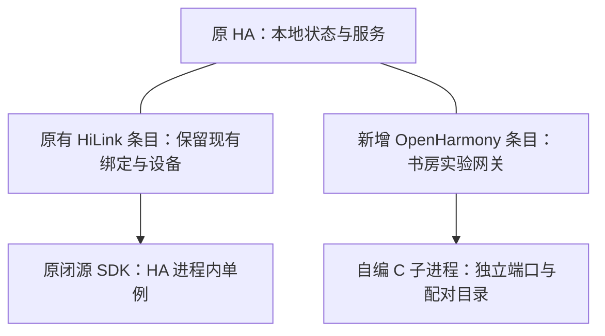

# OpenHarmony 与现有 HiLink 桥接融合计划

状态：历史实验计划。其“双后端、独立网关条目”的生产目标已被用户最新要求替代，后续以[风扇能力复用、单网关整合与上游贡献计划](reusable-fan-single-gateway-contribution-plan.md)为准。本文件保留已完成实验和旧决策记录，下列旧 M4/M5 不再作为当前上线执行步骤。

## 目标和边界

把已经配对并通过控制验证的 OpenHarmony 实验网关迁入原 HA，由原 HA 直接调用本地实体和服务；原 HiLink 桥接继续负责现有设备，现有灯光功能、绑定及米家自动化保持不变。先接入书房风扇六档、自然风、正反转和风扇原生定时。

融合采用“同一个 HA、两种后端、独立条目与生命周期”。首批上线保留实验网关已配对的八张卡片，不改 key、PID、SN 或子设备 ID；灯光卡片和相关实体在此次迁移中只读。完整灯光映射继续保留，是否随后在新卡片启用灯光写入另行安排。不开启全屋自动接管，不迁移旧 HiLink 网关身份，不调用旧桥接的解绑或恢复出厂接口。

更新 Python 集成需要安排一次 HA 重启，期间旧桥接会短暂中断。目标是重启后原有条目、绑定和功能恢复，不承诺零中断。

## 当前基础与证据边界

| 项目 | 已知状态 | 对融合的意义 |
| --- | --- | --- |
| 生产环境 | 只读核对为 HA OS / x86_64 / Core 2026.10.1 / Python 3.14.6，配置根目录 `/config` | 目标架构须重新构建与运行验证；实施前重新核对环境 |
| 独立环境 | Linux ARM64 上真实 HA Core 托管 C 子进程 | 已验证 HA 原生路由，但不能当作 x86_64 验收 |
| 实际控制 | App 开关、三档、六档、自然风、正反转通过 | 二、四档持续性按用户确认的外部自动化影响跳过，不修改自动化 |
| 定时和重启 | App 仅风扇两分钟，整机重启后仍有剩余时间，到时风扇关闭 | 原生定时无需从 Python 内存恢复 |
| 启停和回退 | App 在停用后无写入；原独立 Linux OpenHarmony 服务回退及再次交回 HA 通过 | 不等于旧闭源 SDK 回退或同一 HA 双后端真实共存通过 |
| 身份 | 八张卡片恢复云端在线，12 份子设备身份文件哈希保持一致 | 迁移必须接管最新完整配对目录，不重新绑定 |
| 上游修复 | CoAP 扩展值、序号及 UDP 消息编号改为逐字节访问，保留 UBSan | 目标架构产物必须包含这些补丁与对应回归 |
| 隔离检查 | 共 16 次真实服务写入均为风扇/风扇定时；9 份灯光相关完整记录未变，13 个实体状态值恢复 | 继续执行同样的写入边界，不把只读核对称为灯光 App 写入验收 |
| 部署能力 | 已有 HA API token，尚未核验生产文件/SSH 部署通道 | API 访问不能代替组件文件安装能力 |

上述结果来自当前工作区原型和独立实验，不是 `main` 已发布功能。原始状态、日志、凭据、证据截图和配对资料留在私有目录，不随计划提交。第一次实际开机后的 C 应答崩溃记录已排除出完整验收，修复后重做了控制与重启。

## 推荐结构

### 条目、状态和控制隔离

- 旧条目缺少 `backend` 字段时继续解释为 `legacy`，保留旧唯一 ID 和原设备管理入口。旧 SDK 仍是进程内单例，不能启动第二份。
- 配置流先选择后端再计算唯一 ID。新增 OpenHarmony 条目使用“后端类型 + 稳定网关身份摘要”，不能依赖目录名或 HA `entry_id` 生成云端 SN。
- 识别原型中唯一 ID 固定为 domain 的已有 OpenHarmony 条目，提供兼容迁移，不因此触碰旧 HiLink 条目或生成新云端身份。
- 首发融合流程新增 OpenHarmony 条目，不把原条目切换为 OpenHarmony。新条目的启用/停用只影响该实例；重复旧 SDK、重复 OpenHarmony 根身份或重复绑定目录均拒绝创建。
- 将原型中 `legacy_attempted` 的全局互斥判断缩小到替换旧后端的兼容路径，允许旧 SDK 常驻时启动独立 C 子进程。不能通过卸载旧 SDK来实现共存。
- 运行状态、选项监听、停止任务和删除处理均按条目归属。消除 `last_backend` 全局值决定删除行为的问题；删除/停用 OpenHarmony 不得进入旧桥接的 `exit_brg` 路径。
- 独立维护网关根目录、回环端口、LAN 端口、C 进程和锁。端口由预检确认空闲，不照搬实验值覆盖旧桥接端口；同机通过运行目录锁避免重复启动。
- 使用原 HA 的 `HomeAssistantTransport`，检查真实设备/实体绑定后直接调用本地服务。正式实例不携带实验 REST token、源状态镜像、测试 `/lab` 控制端点或 Mac/SSH 数据转发。
- 将当前仅在测试源适配器里的“只写风扇及其原生定时”限制落实到正式 OpenHarmony 实例策略。HA 配置页明确显示灯光只读策略，服务写入在路由层拒绝；智慧生活模板不能显示权限时，用卡片名称或说明标识只读，不能伪造操作成功。旧 HiLink 灯光路由不改。

## 实施阶段

### M0：形成可复现的实现基线

- [x] 盘点当前未提交的配置流、OpenHarmony 后端、配置映射及实验 C 源码，区分可交付实现、实验工具、生成产物和私密运行资料。
- [x] 在后续实现提交中保存必要源码、补丁、固定依赖版本、构建入口和脱敏说明；不将整个 `experiments/` 目录直接暂存。
- [x] 保存可复核的测试结果摘要，避免克隆分支后依赖未提交的私有证据文件才能理解计划。
- [x] 保留未纳入基线的历史工具与私密资料，不覆盖、不清理、不整目录暂存。

完成条件：后续实现分支可从已提交源码重建产物；token、PIN、AC Key、配对 KV、日志和私有 profile 不进入 Git。

### M1：完成同一 HA 的双后端共存

- [x] 实现上述唯一 ID、旧条目兼容和后端独立状态管理。
- [x] 新增 OpenHarmony 条目可以在旧条目已经加载时独立启用、停用、重载和删除；保持旧 SDK 回调、设备表和状态监听有效。
- [x] 校验同根身份、同目录、端口冲突和设备范围；错误时只将新条目标记为设置失败，不自动启动另一后端。
- [x] 对新条目实施风扇写入白名单，保留八张卡片身份与完整灯光配置，并拒绝灯光及灯定时写入。
- [x] 明确历史单条目“切换后端”和新“共存接入”的界面差异，保留旧 SDK 不能热卸载的重启提示。

完成条件：独立 HA 中旧条目加载后可启动新条目；新条目的启停/删除/故障不会关闭、解绑或重新初始化旧 SDK。

2026-10-16：M0、M1 的源码与隔离验证已完成。新 C 为真实 Linux ARM64 进程；旧 SDK 使用调用替身，保留真实 Python/ctypes 路由、状态监听和设备归属检查。真实闭源 SDK 共存及 x86_64 验收仍留在 M2，不据此部署生产。详情与复现步骤见[双后端共存说明](../openharmony-coexistence.md)。

### M2：x86_64 构建与对应平台验证

- [x] 构建入口显式区分 `x86_64`、`aarch64` 及输出目录，生成静态 Linux 程序，记录源码版本、依赖哈希、二进制架构和 SHA256。
- [x] 保留网络字节对齐补丁和检查器，在真实 x86_64 Linux 中运行 `coap_alignment_test` 及多子设备路由回归；交叉编译成功或 ARM64 运行不算通过。
- [x] 使用匹配目标版本的 x86_64 HA 独立实例，覆盖双条目共存、配置保存、进程异常恢复、启停/删除、HA 重启及目录保留。
- [x] 对旧 SDK 使用隔离的运行目录及身份验证真实初始化和共存，不能把生产配对身份同时复制到测试环境运行。SDK 调用替身的证据单列，不能替代真实共存结论。

完成条件：x86_64 程序真实运行、无检查器崩溃，新旧后端共存证据满足上线要求；若真实旧 SDK 条件不足，保留未验收项并停止推进上线。

2026-10-16：M2 已在独立 QEMU 全系统 x86_64 Linux 虚拟机完成。使用原始旧 SDK 和真实新 C 进程，在 HA 2026.10.1 中通过六个独立 HA 进程场景。旧 SDK 使用全新未配对身份，原生初始化、监听、回调本地路由、启停及身份恢复已核对；未将其表述为旧 SDK 云端控制验收。结果和复现步骤见 [x86_64 与真实 SDK 验证](../openharmony-x86-sdk-validation.md)。物理主机性能及生产迁移不在此次验收内。

### M3：安装包、备份和部署预检

- [x] 提供带版本号和文件清单的保留式集成安装包，不覆盖目标旧 SDK、原产品表/适配器、私有 profile 和现有运行配置；不以实验目录覆盖旧桥接目录。
- [x] 实现离线安装预检与原生实例启用预检，分别检查 HA/CPU、包版本/哈希、已确认文件通道、空间、运行 UID/权限，以及可执行权限、实际网卡、端口、当前实体、固定 profile 和服务目录；生产检查须在实际部署入口可用后执行。
- [x] 实现组件和集成条目的冷备份、校验及选择性还原工具与操作说明，生产冷备份留待取得文件通道及维护窗口后执行；新网关仍使用 `/config/.storage/hwhomebridge/openharmony/<instance>/` 独立目录，离线升级工具不备份或交接运行 KV。
- [x] 额外创建并下载、校验原 HA 在线配置归档，包含完整集成条目；归档内运行中的旧 SDK KV 只作应急资料，不提供一致性保证，不用于配对交接。
- [ ] 完成 HA OS 文件/SSH 部署入口的写入条件、原权限及停机维护验证。现有 File editor 读取已通过 Ingress 验证，但系统命令通道、写入与停机条件未验证，不能据此安装；API token不能直接当作宿主文件系统权限。
- [x] 制作试运行清单和回退操作说明，默认只预检；文件安装与 HA 启动分开，跨主机身份交接仍留在 M4。

完成条件：在独立环境验证安装和还原，备份可读取，产物及目录校验通过；缺少部署通道时不操作生产运行目录。

2026-10-16：M3 的工具和独立安装/还原验收已完成。`1.1.0b3` 安装包包含两种架构的静态程序；在全新未配对的 x86_64 HA 环境，从旧版 `1.0.0` 组件完成冷备份、保留式安装、真实双后端加载、HA 重启及还原后旧 SDK 加载。原组件 42 个文件与权限恢复一致，其他集成的新条目及最新运行数据保留，旧 SDK 解绑调用始终为 0。17 项文件安全回归在 Mac/Linux 通过。操作说明见 [安装、备份与预检](../openharmony-installation.md)，脱敏结果见 [M3 验证](../../experiments/openharmony_bridge/m3-verification.json)。原 HA 仅做 API 只读核对；系统文件通道、生产冷备份和目标启用预检仍未完成，当前工具只适配本地 Podman，不能直接当作 HA OS Docker 部署工具。暂不进入 M4 的生产身份交接。

2026-10-16 后续只读预检：原机确认为 HA OS 18.3、amd64、Core 2026.10.1，主网卡为 enp2s1。已有 File editor 6.0.0 的文件读取已打通，38个静态组件文件和1个桥接条目经两遍校验后保存在本机私有目录，不含运行 KV，也不是冷备份。在本机以生产文件叠加安装包，配置校验通过、22个保留文件不变，原机 SDK 与 M2 同哈希。两套 SSH 缺少认证配置而处于 error，Samba 未启动，现存旧 partial 备份均不含 HA 配置。12项新增只读回归通过，本轮没有安装、重启或变更插件配置。系统命令通道、实际权限/端口及生产冷备份继续保留待办，详见[生产只读预检](../production-readonly-preflight.md)及[脱敏报告](../../experiments/openharmony_bridge/m3-production-preflight.json)。

2026-10-16，b4 补充：正反转修复已打入 `1.1.0b4`，新包在独立 x86_64 Linux 完成离线安装、还原，原42个文件及权限恢复一致。原 HA 已创建并下载校验一份在线 HA 配置归档，含完整集成条目，排除数据库及插件；它不替代冷备或配对交接。原组件、桥接条目和13个源实体完整状态记录保持不变，原 HA 没有安装、停止或重启。独立维护入口、现场运行条件和生产冷备继续保留待办，详见 [b4 发布与预检](../m3-b4-release-preflight.md)。

### M4：把实验配对身份交接到原 HA

- [ ] 迁移前对照原 HA 本地实体及卡片快照，核对根 SN、子设备 key/PID/SN/ID、原虚拟开关及所有持久化文件；保留历史身份文件，不清理已配对目录。
- [ ] 在目标主机先准备静态程序、公开 profile、CA、实例配置和只读预检；不提前启动同一根身份。
- [ ] 停止当前 Linux 实验网关并关闭其自启动，确认进程退出及端口/本机锁释放，再导出最新完整 SDK KV 和身份。不得复制运行中的目录，也不得用早期备份替代最新配对状态。
- [ ] 使用受保护的交接清单传输到目标临时目录，核对文件哈希和身份后原子落位。只调整目标 CA 路径、网卡、端口、架构和属主，不改云端身份或已绑定卡片 key。
- [ ] 两台主机之间不能依赖 `flock` 互斥；交接工具须记录源/目标所有者及步骤，取得源停止的可验证结果后才启动目标。连接超时、目标状态不明时，不自动拉起另一方。
- [ ] 在安排的维护窗口安装组件、重启原 HA，确认旧 HiLink 条目正常加载，再启用新增 OpenHarmony 条目。

完成条件：原 HA 同时运行旧桥接与新条目；新网关八张卡片云在线，根/子身份保持，无新 PIN 回调或重新绑定，实验主机不再持有活动身份。

### M5：生产验收、回退与观察

- [ ] App 验证新卡片开关、三档/六档、自然风、正反转，关联 C 回调、本地 HA 服务调用及稳定回读。
- [ ] App 显式选择“仅风扇”设置原生定时，重启 HA 后核对剩余时间和实际到时关闭；灯定时始终未启用。继续跳过外部自动化影响下二/四档的持续性，不修改米家自动化。
- [ ] 停用新条目后 App 点击无 HA 写入，再启用恢复控制；旧 SDK 状态、回调与现有设备列表保持有效。
- [ ] 生产灯光保持只读对照：检查原条目、绑定及状态；灯光实际开关回归在隔离灯或已安排的实验设备上进行，不将只读观察称为真实灯光控制验收。
- [ ] 如需返回 Linux，先停止目标 HA 的新条目、确认 C 已停止，再将目标上最新的 KV/身份反向交接到原实验环境；原 HA 的旧桥接继续运行。所有者不明时保持停用，不冒险双开。
- [ ] 区分“停用 OpenHarmony”“返回原 Linux 实验服务”“还原集成代码”三种回退。还原旧组件前先停新条目，恢复已验证备份并安排 HA 重启；不通过删除旧集成触发解绑。
- [ ] 建议先观察 24 小时，记录异常退出、自动重载、云端离线、误写和旧桥接异常；未完成前标注为观察期，不声称长期稳定已通过。
- [ ] 最终恢复风扇、定时及临时平板设置，核对没有灯光写入、没有自动化配置变化，保存脱敏验收摘要。

完成条件：实际控制、启停、重启和需要的回退路径有各自证据，旧桥接保持正常；观察期状态单列。

## 必须覆盖的失败场景

| 场景 | 预期行为 |
| --- | --- |
| 新条目配置缺失、实体不可用或架构/哈希错误 | 新条目失败并给出可定位原因，旧桥接继续运行 |
| 回环/LAN 端口冲突、目录被占用、重复根身份 | 启动前拒绝，不抢端口、不改身份 |
| C 进程中止或 HA 关闭 | 只回收新条目所属资源，保留 SDK KV；不解绑旧桥接 |
| 删除 OpenHarmony 条目时旧后端也存在 | 不能因为全局状态误调用旧 SDK 清理函数 |
| 云端控制失败或二/四档被既有自动化改写 | 不伪造成功，不修改外部自动化 |
| 灯或联合灯/风扇定时请求 | 首批迁移路由拒绝灯写入；仅风扇定时路径可执行 |
| 跨主机交接中断或目标启动结果未知 | 不自动双开；查明所有者并停止当前方后才能继续交接 |
| 首次启动失败后的反向交接 | 目标先停止，使用其最新持久化状态；不恢复旧 KV 快照假装回退 |

## 后续提交建议

1. 原型源码及可复现构建基线：只提交审查过的必要实现与公开配置。
2. 同一 HA 双条目共存及生命周期隔离，附故障边界验证。
3. x86_64 构建、依赖补丁和平台验收。
4. 安装/备份/预检及双向身份交接工具。
5. 生产操作说明与脱敏验收结果。实际凭据、配对目录和原始日志不提交。

此次计划提交不推送、不部署、不触发 HA 重启。未来执行 M4 时再依据已经准备好的安装包、备份和维护窗口进行上线。

## 分工说明

Jev 辅助将任务归类为共存、平台、迁移、验收和交付；分类仅用于组织计划。架构、跨主机所有权、旧 SDK 生命周期及验收边界由 Codex 复核。本计划不引入运行时 Jev 依赖。
