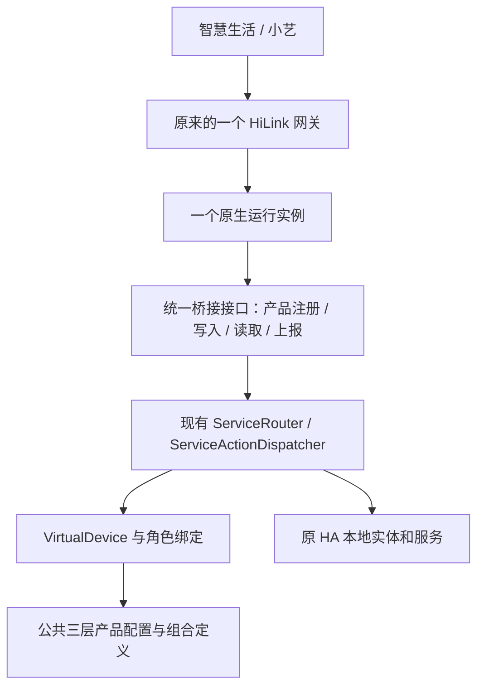

# 风扇能力复用、单网关整合与上游贡献计划

状态：S0已完成静态接口检查，但原网关扩展门槛尚未通过。S1公共风速、模式、方向、角色绑定、原生定时、组合规划及HA本地传输已提炼并在独立环境验证，已提交干净贡献分支；真实单网关原生注册、配置流接入和发布安装仍待完成。该计划替代此前“双后端、独立网关条目”的生产迁移目标。原 HA 暂不安装、停止或重启。

## 1. 最终交付标准

最终是原来的 `hwhomebridge` 集成、原来的一个生产网关，在原有设备发现、产品匹配、控制路由和配置页面内增加可复用的风扇能力。

- 原 HA 保留一个集成条目、一个活动网关身份、一个生产原生运行实例。不是把两个网关放进同一个 HA，也不是只把第二个网关改名或隐藏。
- 已有灯光等设备的 SN、PID、绑定、功能、集成条目及米家自动化保持兼容。
- 新增风扇通过公共框架接入；书房型号只是一个厂家适配器。下一种同类风扇应主要增加配置，不再复制一套后端。
- 书房支持实际六档、自然风、正反转及原生定时；主灯、亮度、色温、氛围灯、灯效及相关设置保留。最终单网关内不以“新灯光只读”代替完整功能。
- 一个网关可以包含多张子设备卡片。此前接受的组合卡片仍可使用，但都由同一个原网关管理，不强求不存在的全功能单 PID。
- HACS 和手动安装继续可用；普通用户不用编译 C、配置 SSH 转发、填写实验运行目录或长期运行 Mac 代理。
- 独立实验环境仅用于开发和验收，不作为生产交付依赖。

## 2. 现有代码实际改了什么

核对基线：上游 `Wangxiaokang666-666/ha_hwhomebridge/main`，提交 `9033ac0`；现有实验分支截至 `45ba9e7`。

本节保留该原型快照的盘点，后续实施进展见第12节。

共80个文件变更，约9,789行新增、56行删除，其中26个组件文件发生变化。这个规模包含实验 C、测试、部署工具和验收文档，不应整体直接作为“原集成新增风扇”的 PR。

| 当前改动 | 已有内容 | 最终处理 |
| --- | --- | --- |
| `__init__.py`、`config_flow.py`、`const.py`、`backend_entries.py`、翻译 | 新旧后端的独立条目、启停、目录和冲突检查 | 改为原条目内的能力、设备选择和兼容迁移；不暴露第二个生产网关入口 |
| `hwbridge.py` | HA 异步辅助、配置驱动适配及生命周期兼容调整 | 保留必要修正，接入统一原生能力检查和公共路由 |
| `openharmony/configuration.py`、`router.py`、`transport.py` | 角色绑定、组合、方向、定时、状态转换和 HA 主循环调用 | 提炼并合入公共注册表、设备模型、动作及路由；不长期维护重复实现 |
| `openharmony/config/*` | 新 PID、六档/自然风、厂家方向修正、灯光及组合映射 | 转入公共三层配置；移除实验命名和私有实例依赖 |
| `openharmony/deployment.py`、`ha_backend.py` | 独立 C 进程及独立配对目录 | 主方案不作为第二个运行实例发布；保留研究参考和必要的资源管理经验 |
| `experiments/openharmony_bridge/*` | 可复现 OpenHarmony C、协议补丁、固定依赖和隔离验收 | 复用协议与测试成果；可发布生产代码移入正式位置，历史设备材料不进用户包 |
| `tools/*` | 保留式升级、原生预检、只读采集、在线备份及39项工具回归 | 改为通用发布/迁移工具；个人 IP、路径和版本特例只留本地操作记录 |
| `manifest.json` | 实验版本 `1.1.0b4` | 最终版本由上游维护者决定，不能等同于已有正式发布 |

关键未完成点：公共 `product_registry.py`、`product_matcher.py`、`virtual_device.py`、`service_router.py`、`service_action.py` 及原公共适配器尚未合入本次风扇实现。旧 `set_speed` 仍为 `speed * 4`，旧 PID 索引仍只有 `001`–`008`。实验的 `child_sn()` 还要求 `OHPOC-` 前缀，不能直接用于原网关。

`b4` 是保留式实验升级包，只用于验证已有安装上的新后端，不能当作已经完成单网关收敛的新装/HACS发布包。

## 3. 必须先解决的原生能力缺口

当前仓库实际只包含 aarch64、amd64 两份旧 `libhilink_bridge.so`，没有项目说明中提到的 `hilink_profile_bridge.c` 等桥接源码。不能因为 Python 加了 PID 就认为原生库已经支持该产品。

主方案：**保留原 HiLink 网关及其身份，扩展它的原生产品/服务支持，并把本次通用映射合入现有 Python 框架。** 这是与保留已有灯光绑定最一致的路径。

第一个技术门槛须得到以下结果之一：

1. 旧库具有可验证的动态产品、profile 和服务注册 ABI，可在同一网关内注册新 PID；或
2. 维护者提供可维护、可构建的桥接适配源码、头文件和必要 SDK 依赖，能够构建两种架构的新库。

必须在隔离环境真实验证：同一个根身份下，旧灯光类别和一个新风扇产品同时完成注册、控制及回读。没有通过前，不显示可用的风扇功能，不进入原 HA 安装。

若旧库不能扩展、也无法取得可重建代码，则暂停原生功能交付，先贡献不改变现有行为的公共框架改进。后续只能另行评估“OpenHarmony 成为唯一引擎并覆盖原有所有产品”的完整替换方案，验证旧身份能否接管、旧设备是否需重新绑定。当前没有这项证据，不能承诺无损替换，也不能以永久双网关绕过该缺口。

## 4. 单网关的目标结构



具体收敛规则：

- 保留原集成条目及默认唯一 ID，不新增 `hwhomebridge:openharmony:*` 生产条目。
- 原生适配器报告 ABI 版本和支持的 PID/服务；旧库没有扩展能力时仅开放原有功能。
- 公共配置是唯一事实来源。PID/服务目录生成原生表及 Python 索引，校验版本/哈希；原 `001`–`008` 顺序不变。
- 厂家只覆盖差异：书房六档百分比、自然风通道及方向极性留在 `xiaomi/sflt11.json`，通用动作不包含该型号分支。
- 物理设备可以生成多张逻辑卡片。旧设备沿用原 SN；只对新增逻辑卡片生成稳定身份，禁止统一改算法导致灯光全部重新注册。
- 组合选择不能抢走旧灯光匹配，也不能为同一灯光再生成一组重复控制卡。先保留旧卡，额外能力按需补充。
- 在 HA 配置页选择/自动匹配设备及能力；高级角色绑定也使用实体选择器，不要求手填个人实例 JSON。
- 生产直接调用 HA 本地状态与服务；不包含 REST token、状态镜像、`/lab` 端点、Mac 代理或 SSH 数据隧道。
- 正常停止、升级和回退保留配对状态；不通过删除旧集成、解绑或恢复出厂实现升级。

拟收敛的代码位置：

| 文件/目录 | 计划职责 |
| --- | --- |
| `product_registry.py` | 统一角色、能力、组合元数据和双向值转换的数据模型 |
| `product_matcher.py` | 继续三层匹配，支持设备能力及逻辑组合，不改变已有匹配结果 |
| `virtual_device.py` | 可选逻辑卡片键和角色绑定；兼容原设备 SN 与查询接口 |
| `service_action.py` | 通用风速、模式、方向、定时和灯光动作；移除无条件 `speed * 4` |
| `service_router.py` | 共用的控制路由、稳定回读、状态上报和实体归属检查 |
| `hwbridge.py` | 单实例原生接口、能力/目录核对、回调生命周期及原网关身份兼容 |
| `config/product_registry.json`、`config/adapters/*` | 公共产品定义、默认映射、厂家差异；新增组合定义与其一起校验 |
| `native/`（拟新增） | 可维护的原生适配、构建/生成脚本、依赖锁和补丁，具体取决于原生能力门槛结果 |
| `tests/`（拟整理） | 无个人设备依赖的回归与全新身份集成夹具 |
| `tools/`、发布 CI（拟补齐） | 新装包、保留式升级包、备份、预检和发布校验 |

## 5. 实施阶段与验收门槛

| 阶段 | 工作 | 完成标准 |
| --- | --- | --- |
| S0：冻结最终架构 | 标记旧双网关计划为历史；核验旧库 ABI/源码与构建条件；整理现有改动 | 能说明新风扇如何进入原网关，拿到隔离的原生注册证据；否则停止原生交付 |
| S1：公共能力提炼 | 把角色、值转换、方向、模式、原生定时合入公共框架；补充其他型号夹具 | 新型号不复制路由；没有风扇配置时，所有旧设备行为不变 |
| S2：单网关原生整合 | 增加 PID/profile/服务；生成目录及能力校验；移除第二生产网关路径 | 仅一个根身份/运行实例；旧灯光和新风扇同时可读写，两架构真实运行 |
| S3：设备与配置体验 | 自动发现、设备/实体选择器、厂家适配、必要组合卡；旧配置兼容迁移 | 用户通过原集成配置功能接入；旧 SN、灯光卡和绑定不变，六档/自然风/方向/定时可用 |
| S4：发行与安装 | CI、完整包、保留式升级包、HACS、迁移/备份文档 | 新装、手动升级、真实 HACS 新装及升级均通过，不依赖本机实验目录 |
| S5：贡献审查 | fork 中拆分 PR、补证据、响应上游审查 | 每个 PR 独立通过 CI；不整体推送实验分支，不混入私人资料 |
| S6：原 HA 部署 | 独立维护入口、现场预检、冷备、维护窗口安装与恢复验证 | 原 HA 保留一个原网关；旧设备正常，新风扇通过 App 控制及重启恢复 |

S1 可先整理为不启用新产品的兼容性贡献，但 S2 不能绕过 S0。原生条件尚不明，暂不承诺固定工期。

## 6. 如何向原仓库提 MR / PR

原仓库在 GitHub，使用名称 PR。目标仓库为 `Wangxiaokang666-666/ha_hwhomebridge`，目标分支 `main`。本次查询当前账号权限为 `READ`，因此走自己的 fork，不直接推送原仓库。GitHub 的[跨 fork PR 流程](https://docs.github.com/en/pull-requests/how-tos/create-pull-requests/creating-a-pull-request-from-a-fork)支持以原仓库为 base、自己的功能分支为 head。

保留 `codex/openharmony-ha-integration-plan` 作为实验和历史证据分支。后续从最新上游 `main` 新建贡献分支，按功能重新整理代码，避免直接合入80文件的实验历史。以下是**待执行示例**，本轮不会 fork、push 或开 PR，也不修改现有 remote：

```sh
# fork 已准备好之后；保留当前 origin，把个人 fork 作为额外远端。
git remote add fork https://github.com/<你的账号>/ha_hwhomebridge.git
git fetch origin
git switch -c codex/reusable-fan-core origin/main

# 仅整理并提交本 PR 的功能、配置和测试；不整目录复制实验实现。
git push -u fork codex/reusable-fan-core
gh pr create --repo Wangxiaokang666-666/ha_hwhomebridge \
  --base main --head <你的账号>:codex/reusable-fan-core \
  --draft --title "Add reusable fan capabilities to the existing bridge" \
  --body-file /tmp/hwhomebridge-pr-body.md
```

建议按以下四个可审查单元提交，每个单元自己的测试随代码一起提交：

| PR | 内容 | 审查重点 |
| --- | --- | --- |
| PR1：公共风扇能力 | 数据模型、双向转换、通用动作、方向与原生定时，未支持时不开放 UI | 不依赖书房设备，不改变旧路由结果，旧库无新能力时仍可工作 |
| PR2：原网关原生支持 | 原生适配源码/ABI、PID/profile目录生成、两架构构建与单身份验证 | 原网关扩展可实现、来源可核对、没有第二实例；缺源码时不能用实验 `.so` 冒充 |
| PR3：设备适配与原配置页 | 通用组合、书房厂家差异、自动匹配/实体选择、SN兼容及完整灯光回归 | 原条目即可接入，不增加网关，不重复已有灯光卡 |
| PR4：发布与安装体验 | CI、HACS发布包、保留式升级包、用户配置迁移、备份及回退文档 | 从干净克隆可构建，新装/升级/还原有实测证据 |

PR2 的原生技术约定应先与维护者核对，不能让 PR1 合并看起来就等于完整风扇功能已经发布。相互依赖的 PR 明确标注依赖；未合并时可用堆叠分支审查，最后均整理到上游 `main`。

不提交：token、PIN、AC Key、设备实际绑定、配对 KV、私有 profile、原 HA 备份、个人 IP/绝对路径、原始日志、账号截图和整套个人验收材料。公开依赖的下载地址、可复现哈希和补丁可以提交；能下载到资源不等于已解决发行来源问题，SDK/profile 的发行条件须与维护者核对。

## 7. 如何打包

同一份已测试源码生成不同用途的产物，不能混用目录结构：

| 产物 | 用途 | 内容/结构 |
| --- | --- | --- |
| `hwhomebridge.zip`（拟新增） | HACS及完整手动新装 | ZIP根目录就是组件内容：`manifest.json`、`__init__.py`、公共配置、可发行的原生依赖；解压目标为 `/config/custom_components/hwhomebridge/` |
| `hwhomebridge-<version>-upgrade.zip`（拟规范） | 已有安装的保留式升级 | 带清单、兼容性信息及选择性更新内容，必须使用配套升级工具，不能直接覆盖解压 |
| `SHA256SUMS`、构建来源/能力清单、依赖说明 | 校验和审查 | 固定源码版本、构建依赖、目标平台、ABI、产品目录及文件哈希 |

完整包必须支持空配置目录安装，不能假定目标已经有旧 `.so`、SDK启动默认配置、公共产品定义或私有实验目录。不能发行的必要资源提供受控导入和明确缺失提示，不夹带个人密钥，也不把缺依赖的包标为“开箱可用”。

HACS 推荐继续原仓库安装，增加 release asset 模式：

```json
{
  "name": "HuaweiHome Bridge",
  "content_in_root": false,
  "render_readme": true,
  "zip_release": true,
  "filename": "hwhomebridge.zip"
}
```

以上只是拟修改字段，保留原项目其他有效字段。HACS 的[发布配置](https://www.hacs.dev/docs/publish/start/)支持 `zip_release` 和 `filename`；其[当前安装实现](https://github.com/hacs/integration/blob/main/custom_components/hacs/repositories/base.py)会把 release ZIP 直接解到集成目录，所以 ZIP 不能再套 `component/` 或第二层 `hwhomebridge/`。

CI 从干净克隆执行：配置/测试 → 两架构构建或核验维护者提供的固定依赖 → ELF/ABI/产品目录核对 → 打两类包 → 干净安装/升级/还原测试 → 生成校验和 → 发布预发行版本。不要直接复用本机未跟踪的构建产物。最终版本号由上游确定，HACS发布需要实际 GitHub Release，不只创建 tag。

## 8. 用户配置如何安全升级

- 默认产品、默认适配器及厂家支持是版本化代码，随正式包更新。
- 用户自定义映射、设备选择、运行参数和配对状态放到 HA 配置存储，建议独立于组件目录的 `.storage/hwhomebridge/user_config/`；原 SDK KV 路径保留兼容，不直接重命名。
- 首次从旧版升级前，通用迁移工具备份组件、完整条目、自定义覆盖及停止所有者后的最新运行状态，生成可核验迁移清单。
- 原来写在组件 `config/` 或 SDK启动配置中的自定义内容，先导出到持久目录，再允许 HACS/手动升级。不能指望新版本启动后找回已被升级器覆盖的文件。
- 后续版本读默认配置再叠加用户覆盖，版本不兼容时明确报错或禁用新增能力，不能清空配对资料。
- 当前 `ha_upgrade.py` 是保留式更新工具，不是 HACS 安装器。两条升级路径必须分别验收，不能把它的通过结果当成 HACS 升级已经通过。

## 9. 安装方式：原项目与最终版本

### 原项目当前方式

仓库 README 给出 HACS 自定义仓库安装和手动安装。当前 `hacs.json` 没有 release ZIP 配置；查询到的 `v1.0.0`、`v1.0.1` Release 均没有附件。最终合并前，原项目的安装入口不因本计划而改变。

HACS：添加原仓库作为 Integration → 下载 → 重启 HA → 添加 `hwhomebridge` → 在配置中取 PIN → 智慧生活绑定 HA 网关。

手动：把仓库内的 `custom_components/hwhomebridge/` 组件内容放到 `/config/custom_components/hwhomebridge/`，最终应直接存在该目录下的 `__init__.py` 和 `manifest.json`，不是把整个 Git 仓库嵌进去；然后重启并按原配置流程绑定。

### 最终版本新用户

1. HACS 下载正式 Release，或把完整包解压到上述唯一组件目录。
2. 重启 HA，只添加一个 `hwhomebridge` 集成并绑定一个网关。
3. 在原配置页自动发现/选择设备，自动加载厂家适配；必要时用实体选择器补充角色。
4. 灯光和风扇都注册到这个网关；用户不需要知道实验 Linux、网卡端口或配对目录布局。

### 旧用户升级

1. 预检维护入口、运行环境、原生能力及已有产品，备份/迁移自定义配置。
2. 在维护窗口停原 HA/原生所有者，完成可核验冷备。
3. 通过已验证的 HACS升级路径或保留式工具更新；不删除原集成，不重新绑定原网关。
4. 重启后先验证旧设备正常，再从原配置页开启新增风扇支持。
5. 失败时停新增功能，按最新状态和组件备份回退；不调用旧网关解绑接口。

## 10. 测试安装与验收矩阵

| 测试层 | 必须覆盖 |
| --- | --- |
| 公共单元/配置 | 六档、其他档数风扇、自然风、厂家方向反转的双向映射、定时单位、无此能力的拒绝/隐藏、unknown/unavailable、越界及错误实体 |
| 旧功能回归 | 原001–008匹配、所有已支持灯光服务、确定性SN、旧条目加载、配置覆盖、回调对象不被回收、HA主循环与C回调无死锁 |
| 原生单网关 | 同一个根身份下旧灯和新风扇同时读写、产品目录一致、异常与重启恢复；两种架构真实Linux运行，不能只交叉编译 |
| 干净新装 | 完整包包含所有可发行必要文件；空 `/config` 可添加并运行唯一网关，无个人目录/凭据依赖 |
| 手动/HACS升级 | 原版安装加自定义适配和旧身份，升级后旧SN/绑定/自定义内容不变；实际HACS点选安装及升级单独验证 |
| 还原/失败 | 包损坏、缺库、ABI或产品目录不匹配、错误权限/端口/配置、升级中断；拒绝错误而不解绑，必要时整包回退 |
| 真实书房设备 | 智慧生活风扇开关、六档/自然风、正反转、原生定时、主灯/亮度/色温/氛围灯/灯效及设置；重启后定时继续，方向回报一致 |
| 环境兼容 | 已验证的HA2026.10.1和维护者承诺的最低版本；官方HA镜像中的libc/依赖也需验证，不能直接继承README全部兼容范围 |
| 生产观察 | 一个网关、原灯光正常、无重复卡/误写/自动化改动；至少24小时观察，长期稳定性单独记录 |

安装与运行测试使用全新身份、假实体和内部网络，不复制生产配对目录。实机配对验收仍在独立环境；同一物理实体同时只有一方有写入权限。

二、四档被米家四档面板同步自动化改写的问题继续按用户要求跳过持续性结论，不修改自动化；“HA枚举8个值”不再误写成“8档”。

## 11. 原 HA 上线和实验网关退出

本阶段依赖 S0–S5，当前只形成计划，暂不实施：

1. 补齐 Core 停止后仍可用的独立维护入口、HA OS部署适配、实际UID/权限和端口检查。
2. 保留已完成的约34 MiB在线HA配置备份作为辅助资料；维护窗口另做停机冷备，不能以在线SDK KV替代最新一致状态。
3. 部署保留原根身份的单网关版本，优先核对原灯光和其他旧设备，失败先回退，不启用风扇。
4. 停止实验网关及其自动拉起；核对唯一写入者，再在原网关添加风扇子卡并完成验收。
5. **不迁移实验网关的根身份到原网关。** 两个不同父网关下的子设备身份也不默认可直接移动；按原网关新增风扇注册处理。原有灯光身份保持，实验风扇卡片若被华为场景引用需单列处理，不改米家自动化。
6. 验收与观察通过后，只清理明确属于实验网关的设备及卡片，归档实验资料且不再启动。最终智慧生活仅保留原生产网关，不调用它的删除/解绑接口。

回退要区分：停用新增风扇能力、回退组件版本、退回实验测试。先停当前写入方，再切换；旧SDK运行状态按最新一致数据处理，不能用过期配对快照覆盖。

## 12. 下一个可执行任务

已推进的第一批实施：

- [原生接口检查与维护者问题草稿](legacy-native-extension-gate.md)：两架构旧库只有11个既有公开接口，未验证动态产品注册；未发外部消息。机器结果记录在`legacy-native-audit.json`，不能代替真实单根身份注册验收。
- [公共风扇能力](../fan-capabilities.md)：公共注册表保存显式参数，公共动作/路由/上报/查询共用风速、模式及方向映射；实验后端也调用同一实现。旧001–008配置、SN及未配置映射的旧动作保留。
- 从上游`9033ac0`创建本地`codex/reusable-fan-core`，提交`ad89cef`，仅8个公共框架、测试及开发文档文件。该分支没有实验后端或第二网关配置流，可作为第一批独立审查差异；没有fork、push或开PR。
- 公共18项在Mac和独立Linux x86_64的官方HA2026.10.1/Python3.14.6镜像通过；实验25项、工具39项、静态ELF检查3项通过。Linux使用无网络、只读容器与公开假实体夹具，不加载SDK、不调用家庭HA。详细边界见[验收记录](reusable-fan-core-validation.json)。

第二批实施已完成，贡献分支新增提交`39d5eb3`：

- [角色、定时与组合能力](../role-timer-compositions.md)进入公共模块。实验目录仅保留身份、云目录、REST测试入口和权限策略适配，原有25项实验回归继续通过；没有加载或重启实际已配对实验网关。
- 公共目录可同时容纳旧品类与新组合，普通发现默认不选择组合适配器。组合显式启用、共享原SNManager，保留旧主灯对象/SN/PID和控制路径，拒绝重复灯光控制、跨设备实体、未确认PID及第二父身份。
- 设备原生定时使用三个角色，先确认时长再启用，合并目标先统一预检；没有软件倒计时或重启补发。状态依赖精确到相关卡片，HA主循环回报不会等待自身。
- 公共46项在Mac及独立Linux x86_64的HA2026.10.1/Python3.14.6通过。额外真实HA Core的状态、服务和实体注册表测试通过，包括旧灯光读写、原生定时取消/重建、读写权限和状态回报；设备均为虚构，没有加载SDK，没有创建或配对网关。详见[第二批验收记录](role-timer-composition-validation.json)。既有工具39项和静态ELF检查3项也通过。
- 没有fork、push或开PR，没有安装、停止或重启原HA，没有访问其token/API、灯光或米家自动化。旧001–008配置、SN算法、原生库和原配置流未改。既有b4包没有重打，不包含这两批公共框架实现。

下一步优先解决原网关PID/profile扩展的C源码或ABI缺口，再核对单网关原生目录、明确SID回调、同根旧灯光/新风扇注册及重启验收，随后接原配置流与发布安装。取得原生证据前不启用新产品、不制作单网关正式包，也不恢复旧M4双网关迁移路线。

第三批已完成[上游/公开源码调查与隔离Linux符号核对](legacy-native-public-source-research.md)：19个仓库、24个分支无原C适配源码；公开`honyar`明确四个回调合同，但只有ARM32 SDK，向x86_64/aarch64链接均架构不兼容。当前旧库的这四个回调既不动态导入也不导出，Linux查询结果相符。尚未取得原适配源码/可用扩展ABI和匹配的64位SDK，S0原生门槛仍未通过。没有启动已配对实验网关或访问原HA；公共贡献分支继续保留可独立审查的Python能力，不把调查工具和替代引擎混入第一批贡献。

第四批已完成[OpenHarmony 唯一引擎的最小隔离评估](openharmony-single-engine-evaluation.md)：一个全新父身份承载旧002灯光和新风扇，App 旧灯开关/亮度/色温、新风扇开关、整组重启均通过；公共旧 VirtualDevice/SN保留。另一份全新旧SDK测试身份完成配对和自身在线恢复，但子控制退出139，完整回退未通过。离线正反例确认旧KV不能直接被OpenHarmony读取，启动器已拒绝仅复制旧SN后在线接管。原HA和生产配对资料没有访问或改动；S0/正式迁移发行门槛仍未通过。接下来优先定位旧SDK实验回调基线及持久化导入合同，再验证同根云端ID、子身份、重启和回退闭环；不把全新实验根配对成功当作原网关无损接管。

Jev在规划轮辅助分类原型状态和贡献方式；实施轮把原生门槛判为“证据不足”、把可继续范围归为“显式配置的公共能力”。代码、ABI证据、架构、测试及部署判断由Codex核对。没有生产部署。
